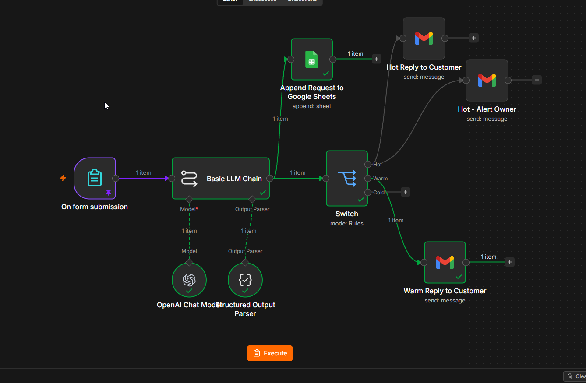
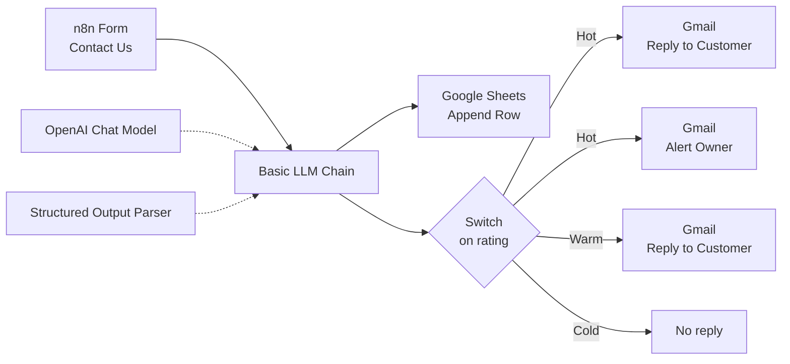
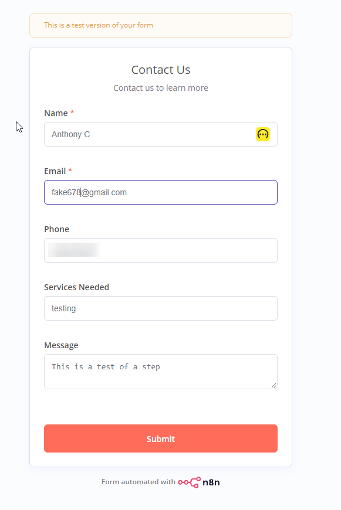
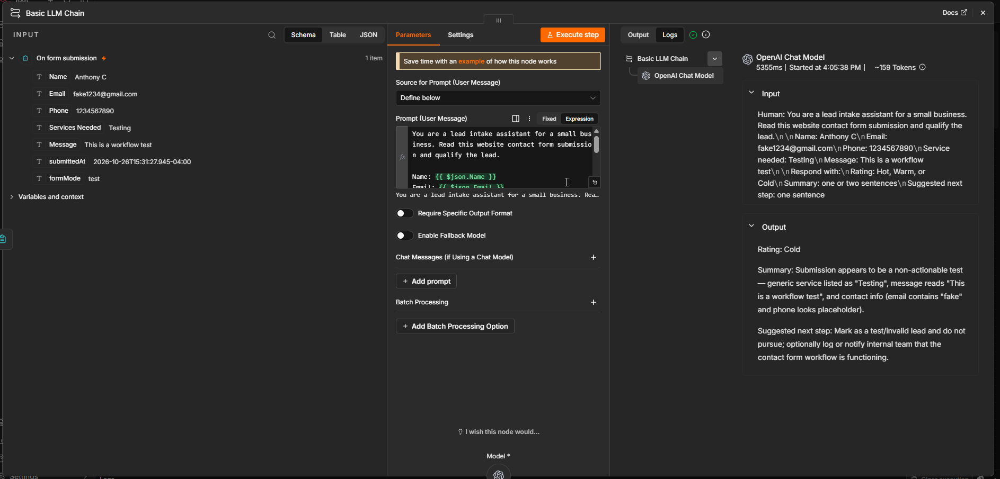
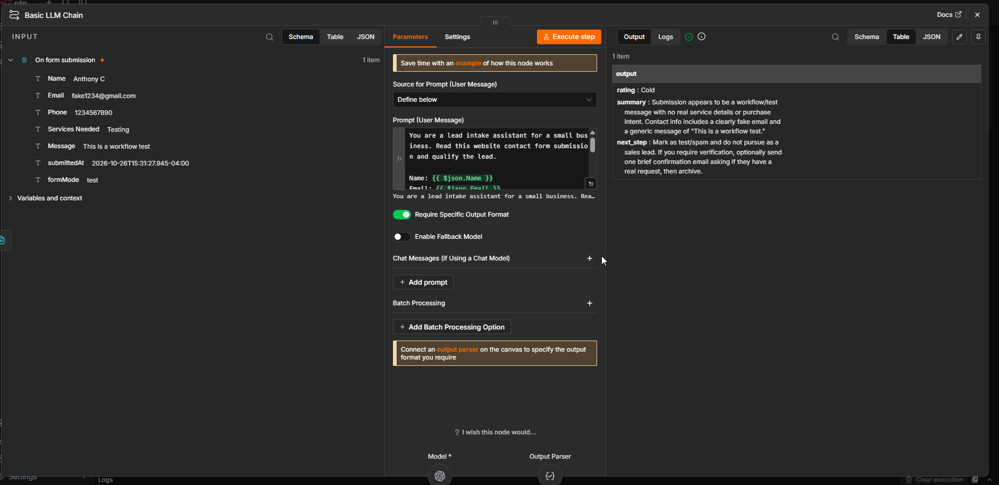
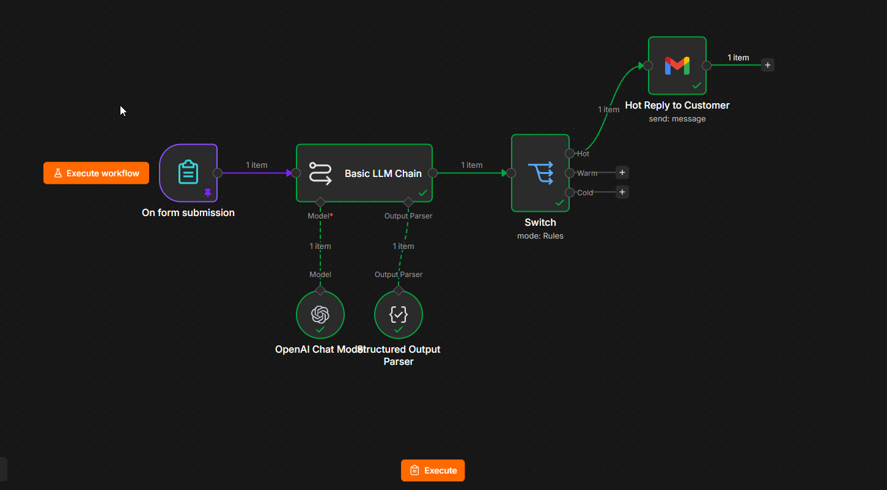

# AI Lead Intake Automation with n8n

A self-hosted n8n workflow that captures website leads, uses an AI model to qualify each one, logs every lead to Google Sheets, and routes Hot, Warm, and Cold leads to different follow-up actions.

Built as a homelab project and as a reference pattern for small-business automation.



## What It Does

1. A visitor submits a contact form (name, email, phone, service needed, message).
2. An AI model reads the submission and returns a structured result: a rating (Hot, Warm, or Cold), a short summary, and a suggested next step.
3. Every lead is appended to a Google Sheets lead tracker.
4. The workflow routes on the rating:
   - **Hot:** sends the customer an immediate reply and emails the business owner an alert with the AI summary and next step
   - **Warm:** sends the customer a friendly follow-up reply
   - **Cold:** logged only

## Architecture



## Stack

- **Hosting:** Ubuntu Server VM on VMware ESXi 8 (Dell R730 homelab)
- **Runtime:** Docker Engine and Docker Compose (installed from Docker's official repo)
- **Automation:** n8n (self-hosted, Community Edition)
- **AI:** OpenAI API through n8n's Basic LLM Chain, with a Structured Output Parser
- **Integrations:** Gmail and Google Sheets via Google OAuth

## Setup

1. Install Docker Engine and the Compose plugin on a Linux host.
2. Copy `docker-compose.yml`, set `WEBHOOK_URL` to the address you will use to reach n8n, then run:
   ```bash
   docker compose up -d
   ```
3. Open `http://<host>:5678`, create the owner account, and import `workflow/lead-intake.json`.
4. Create credentials in n8n:
   - **OpenAI:** an API key from the OpenAI platform (set a monthly spend limit)
   - **Gmail and Google Sheets:** an OAuth client from Google Cloud (enable the Gmail, Sheets, and Drive APIs, add yourself as a test user, and register n8n's OAuth redirect URL)
5. Create a Google Sheet with the columns `Date, Name, Email, Phone, Service, Message, Rating, Summary, Next Step` and select it in the Sheets node.

## Design Notes

- **Automation, not an agent.** Qualifying a lead is a fixed task with no tools, so a Basic LLM Chain is simpler and cheaper than an AI Agent node.
- **Structured output.** The model returns `rating`, `summary`, and `next_step` as separate JSON fields, so the Switch node can route on one clean value instead of parsing free text.
- **One logging node.** Google Sheets is connected directly off the LLM Chain, alongside the Switch, so every lead is logged regardless of rating.
- **Swappable model.** The model is a sub-node. A local model (Ollama) was considered for privacy, but CPU-only inference took up to a minute per reply, so a cloud API was used to match a typical client deployment.

## Troubleshooting Notes

| Symptom | Cause | Fix |
|---|---|---|
| `Invalid URL` on the LLM Chain; form test tab did not open | `WEBHOOK_URL` still contained a placeholder. The stack trace (`appendResumeToken`) showed n8n failing to build its own URL, not the AI provider's. | Set a real URL and recreate the container with `docker compose up -d` |
| Prompt preview showed `undefined` | The chain defaulted to a chat trigger input (`$json.chatInput`) | Set the prompt source to "Define below" |
| Owner alert email had blank AI fields, but every node showed green | The alert node was chained after another Gmail node, so `$json` held Gmail's output instead of the AI's | Connected the alert directly to the Switch and referenced the source node by name: `$('Basic LLM Chain').item.json.output.summary` |
| Google sign-in: `Error 403: access_denied` | OAuth app in Testing mode with no test users listed | Added the account under Google Auth Platform > Audience > Test users |
| Google rejected the redirect URL | Google accepts only HTTPS on a real domain, or localhost | Used an SSH tunnel (`ssh -L 5678:localhost:5678 user@host`) and a localhost redirect URL for the lab |

## Limitations and Next Steps

- The lab runs over HTTP on a private network, so the form is not reachable from the internet yet.
- The Google OAuth app is in Testing mode, so the sign-in expires about every 7 days.
- Planned: HTTPS through a Cloudflare Tunnel on a dedicated domain, publishing the Google OAuth app, and activating the workflow on its production form URL.

## Screenshots

| | |
|---|---|
|  |  |
|  |  |

Setup steps (terminal, sensitive details blurred): `screenshots/01` through `screenshots/05`.
